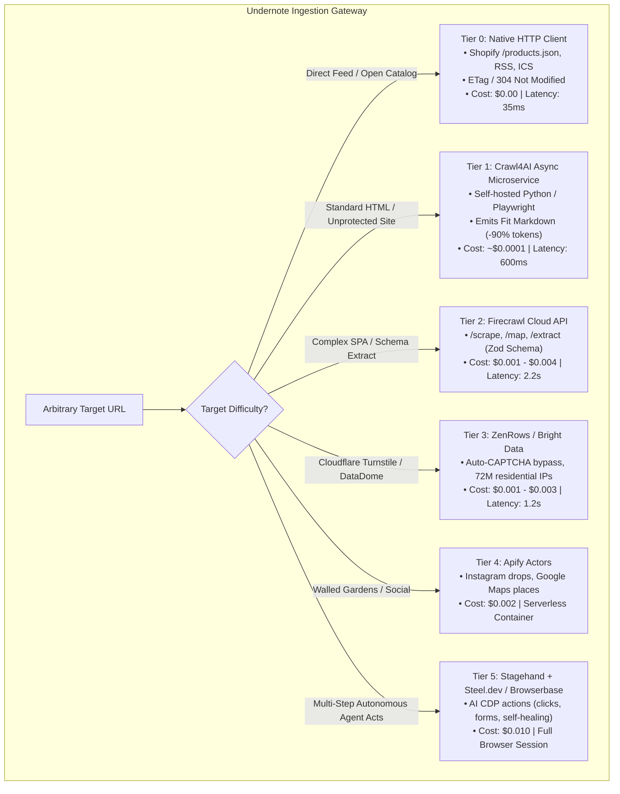

# Master Catalog: Data Sources & Crawling APIs for Undernote (Part 1)

---

## Executive Architectural Principle: Universal Discovery Across Infinite Interests

Undernote is not tied to any single lifestyle niche. A user might care about **permaculture and heirloom seeds, somatic therapy and mental health, acoustic chamber concerts, Japanese joinery hand tools, rare vinyl pressings, or architectural theory**.

To support **any arbitrary human interest**, the data foundation cannot be hardcoded to specific commercial stores or travel routes. Instead, it relies on four universal layers:

```
┌────────────────────────────────────────────────────────────────────────────────────────┐
│                          UNDERNOTE PART 1: THE DATA UNIVERSE                           │
├────────────────────────────────────────────────────────────────────────────────────────┤
│ Layer 1: Universal Web Protocols      │ schema.org JSON-LD, Shopify & WooCommerce JSON,│
│ (Zero-Auth, Category-Agnostic)        │ RSS/Atom/WebSub, iCalendar (RFC 5545)          │
├───────────────────────────────────────┼────────────────────────────────────────────────┤
│ Layer 2: Autonomous Semantic Discovery│ Exa.ai (Neural Personal Sites), Brave Search   │
│ (Finding Unregistered Indie Gems)     │ (AI + POI), Marginalia/Wiby, Kagi Small Web    │
├───────────────────────────────────────┼────────────────────────────────────────────────┤
│ Layer 3: Planetary Knowledge Graphs   │ OpenStreetMap (Overpass), Wikidata, OpenAlex   │
│ (Universal Open Databases)            │ (250M papers), OpenLibrary, Internet Archive   │
├───────────────────────────────────────┼────────────────────────────────────────────────┤
│ Layer 4: Crawling & Unlocking APIs    │ Crawl4AI (Fit Markdown), Firecrawl, ZenRows,   │
│ (The Ingestion & Scraping Engines)    │ Apify Actors, Bright Data, Stagehand + Steel   │
└────────────────────────────────────────────────────────────────────────────────────────┘
```

---

## 1. Universal Zero-Auth Web Protocols (Category-Agnostic)

Across the entire web, regardless of whether someone sells heirloom seeds, vintage synthesizers, natural textiles, or offers pottery workshops, the internet runs on universal open data protocols:

### 1.1 `schema.org` (JSON-LD, Microdata, RDFa)
Over 50% of top web domains embed machine-readable structured data inside raw HTML (`<script type="application/ld+json">`). A single universal JSON-LD extractor parses any page into a normalized Undernote candidate card with zero site-specific scrapers.

| Schema Entity | Key Fields Extracted | Target Lifestyle Use Cases |
| :--- | :--- | :--- |
| **`schema.org/Product`** | `name`, `description`, `image`, `brand`, `offers.price`, `offers.priceCurrency`, `offers.availability`, `aggregateRating` | Tools, instruments, books, apparel, pantry items, audio gear |
| **`schema.org/Event`** | `name`, `startDate`, `endDate`, `location` (`Place` with `geo` or `VirtualLocation`), `organizer`, `offers.price` | Acoustic recitals, gallery openings, garden walks, retreats, workshops |
| **`schema.org/Place`** | `name`, `geo` (`latitude`, `longitude`, `elevation`), `address`, `openingHoursSpecification`, `telephone` | Sanctuaries, botanical gardens, tea houses, ceramic kilns, studios |
| **`schema.org/Book`** | `name`, `isbn`, `author`, `publisher`, `datePublished`, `numberOfPages`, `bookFormat` (Hardcover/Paperback) | Monograph releases, translations, essays, literary prints |
| **`schema.org/Article`** | `headline`, `author`, `datePublished`, `description`, `mainEntityOfPage` | Thought pieces, deep essays, field notes, investigative journalism |
| **`schema.org/Course`** | `name`, `description`, `provider`, `hasCourseInstance.startDate`, `courseMode` (in-person/online) | Traditional apprenticeships, writing seminars, botanical courses |
| **`schema.org/Recipe`** | `name`, `recipeIngredient`, `recipeInstructions`, `recipeCategory`, `nutrition` | Fermentation formulas, seasonal foraging recipes, slow cooking |

### 1.2 Universal Indie E-Commerce Protocols (Shopify & WooCommerce)
Thousands of independent craftspeople, heirloom seed banks, bespoke tailors, and bookshops run on two open protocols:

1. **Shopify Storefronts (`/products.json`)**:
   - Every Shopify store exposes its entire catalog at:
     ```http
     GET https://{store-domain}/products.json?limit=250&page=1
     GET https://{store-domain}/collections/{collection-slug}/products.json?limit=50
     ```
   - Unauthenticated, returns variants, real-time inventory (`available: true/false`), SKU, high-res images, tags.
   - **Sub-50ms Delta Ingestion**: Send `If-None-Match: "<ETag>"`. If no drops or price changes occurred, returns **`HTTP 304 Not Modified`** (0 bytes payload, finishes in ~35ms).
2. **WooCommerce Public Store API (`/wp-json/wc/store/v1/products`)**:
   - Modern WordPress shops expose an unauthenticated public Store API.
   - Returns: `id`, `name`, `slug`, `description`, `prices.price`, `is_in_stock`, `low_stock_remaining`, `images`, `tags`, `attributes`.

### 1.3 Open Syndication Protocols (RSS 2.0, Atom 1.0, JSON Feed, WebSub)
- The open web's nervous system for publishing: Substack newsletters, independent blogs, research labs, film journals, and venue announcement feeds.
- Auto-discovery via `<link rel="alternate" type="application/rss+xml" href="...">`.
- **WebSub (W3C Recommendation)**: Transforms polling into instant push events. Hubs send HMAC-signed webhooks to Undernote the second an author or maker publishes.

### 1.4 Temporal & Calendaring: iCalendar / ICS (RFC 5545)
- Standard format for cultural exhibition series, recurring workshops, retreats, and festivals.
- Native RRULE expansion allows the engine to compute recurrence schedules (e.g. "every third Thursday evening") without polling the origin server.

---

## 2. Autonomous Semantic Search & Indie Web Discovery Engines

How does Undernote discover things when the system does not already know which websites exist?

```
┌────────────────────────────────────────────────────────────────────────────────────────┐
│                        THE MAINSTREAM SERP BIAS VS. INDIE DISCOVERY                     │
├────────────────────────────────┬───────────────────────┬───────────────────────────────┤
│ Query Intent                   │ Mainstream SERP       │ Undernote Indie Stack         │
│                                │ (Google / Bing)       │ (Exa Neural + Marginalia/Kagi)│
├────────────────────────────────┼───────────────────────┼───────────────────────────────┤
│ "quiet silent meditation       │ Commercial SEO ads,   │ Direct personal websites of   │
│ retreat near nature"           │ TripAdvisor listicles,│ rural monasteries, hermitage  │
│                                │ wellness resort spam  │ sanctuaries, forest retreats  │
├────────────────────────────────┼───────────────────────┼───────────────────────────────┤
│ "heirloom seed preservation    │ Amazon seed ads,      │ Grassroots seed swaps, farmer │
│ collective"                    │ affiliate blogs,      │ cooperative blogs, regional   │
│                                │ generic e-commerce    │ seed library registries       │
├────────────────────────────────┼───────────────────────┼───────────────────────────────┤
│ "hand-thrown stoneware         │ Wayfair mass imports, │ Individual studio potters,    │
│ ceramics studio"               │ Etsy promoted listings│ wood-fire kiln journals, local│
│                                │ dropshipped plates    │ craft guild apprenticeships   │
├────────────────────────────────┼───────────────────────┼───────────────────────────────┤
│ "somatic psychotherapy         │ Directory lead-gen,   │ Independent clinicians, local │
│ workshops"                     │ BetterHelp ad tech,   │ embodiment study groups,      │
│                                │ clinical SEO funnels  │ somatic reading collectives   │
└────────────────────────────────┴───────────────────────┴───────────────────────────────┘
```

### 2.1 Autonomous Neural Discovery APIs
1. **Exa.ai (formerly Metaphor)**:
   - **How it works**: Embeds the web in a vector space trained on link prediction. Queries are natural language semantic statements.
   - **`category: "personal site"`**: **The breakthrough filter**. Strips corporate aggregators, directories, and corporate portals, isolating personal digital gardens, artisan journals, and maker portfolios.
   - Auto-content extraction: Returns clean Markdown (`contents: { text: true }`) and semantic highlights answering sub-questions.
   - Pricing: **$7.00 per 1,000 queries** ($12–$15 for deep reasoning).
2. **Tavily API**:
   - Search engine built specifically for AI agents and LLM context.
   - `search_depth: "advanced"`: Executes multi-query expansion, deep page scraping, semantic deduplication, and neural reranking.
   - **`/extract` endpoint**: Converts up to 20 candidate URLs into clean, ad-free Markdown simultaneously.
   - Pricing: **$5.00 – $8.00 per 1,000 requests** (1,000 free queries/month).
3. **Perplexity API (`sonar` / `sonar-pro`)**:
   - Web-grounded generative models returning live numbered citation links.
   - Best used for **fact-checking and date verification** on active user watches.

### 2.2 Independent & Small-Web Search APIs
1. **Brave Search API**:
   - Completely independent 30B+ page index (zero Google/Bing dependency).
   - **Data for AI**: Native `Accept: text/markdown` returns LLM-ready semantic chunks.
   - **Local POI API**: Index of 200M+ global Places of Interest (coordinates, hours, price tiers) at **$5.00/1k queries** (6x cheaper than Google Places API).
   - Sub-300ms latency.
2. **Kagi Search API**:
   - Anti-SEO, ad-free search index with the **"Small Web" project** (human-curated index of non-commercial digital gardens).
   - Pricing: **$12.00 per 1,000 queries**.
3. **Marginalia Search & Wiby**:
   - Radical non-commercial search engines designed to index only text-heavy, non-commercial websites, personal homepages, and indie blogs. Free / ~$1.00/1k queries.
4. **The "Million Short" Negative Filtering Technique**:
   - Undernote maintains an in-memory blocklist of the **Tranco Top 100k Most Visited Domains** (TripAdvisor, Yelp, Amazon, Medium, Forbes).
   - Automatically exclude these domains to reveal the authentic long-tail web.

---

## 3. Planetary Public Knowledge Graphs & Open Databases

### 3.1 OpenStreetMap (OSM) & Overpass API / Overpass Turbo
The world's largest, community-verified geospatial knowledge graph. 100% free and unauthenticated.
* **Interpreter URL**: `https://overpass-api.de/api/interpreter`
* **Query Language**: Overpass QL with semantic tag querying:
  * `craft=*`: `pottery`, `carpenter`, `shoemaker`, `blacksmith`, `tailor`, `bookbinder`
  * `shop=*`: `books`, `second_hand`, `musical_instrument`, `antiques`, `craft`, `tea`
  * `leisure=*`: `garden`, `nature_reserve`, `bird_hide`, `quiet_zone`
  * `historic=*`: `archaeological_site`, `heritage`, `building:architecture=*`
  * `amenity=*`: `library`, `arts_centre`, `community_centre`, `public_bookcase`
* **Example Query**:
  ```overpassql
  [out:json][timeout:35];
  area["name"="Edinburgh"]["boundary"="administrative"]->.searchArea;
  (
    nwr["craft"~"pottery|bookbinder"](area.searchArea);
    nwr["shop"="books"]["second_hand"="yes"](area.searchArea);
    nwr["leisure"="garden"]["garden:type"="botanical"](area.searchArea);
  );
  out center tags;
  ```

### 3.2 Wikidata SPARQL Query Service (`query.wikidata.org`)
Structured knowledge graph containing over 115 million items. Zero-auth SPARQL endpoint.
* **Capabilities**: Querying historical craft movements, architecture vernaculars (Brutalism, Bauhaus, vernacular timber), ancient instruments, author monographs, and cultural lineages.
* Direct SPARQL querying linking historical entities with geographic coordinates and Commons imagery.

### 3.3 Open Literature & Science
1. **OpenLibrary REST API & Google Books API**:
   * Global literature, philosophy, monographs, non-fiction across all languages.
   * OpenLibrary: 100% free, covers API (`covers.openlibrary.org/b/id/{id}-L.jpg`), subject browsing (`/subjects/pottery.json`).
   * Google Books: 1,000–100,000 free req/day for descriptions, editions, and retail pricing.
2. **OpenAlex API (250M+ Research Papers)**:
   * **Base URL**: `https://api.openalex.org/works`
   * Open index for scientific, psychological, somatic, cognitive, and environmental papers.
   * Zero-auth with high-speed **polite pool** (`mailto=...`).
   * Reconstructs full paper abstracts via `abstract_inverted_index` with direct Open Access PDF links.
3. **Crossref & Semantic Scholar**:
   * Authoritative DOI resolution, citation graphs, influential citation counts.
4. **Internet Archive API (`archive.org`)**:
   * Digitized rare manuscripts, vintage culinary books, out-of-print architectural sketches, historical 78rpm field recordings.

### 3.4 Cultural, Sound & Moving Image
1. **The Movie Database (TMDb) + JustWatch**:
   * Global documentary, international cinema, and film catalog.
   * Streaming availability endpoint (`/movie/{id}/watch/providers`) returns country-scoped streaming links (MUBI, Criterion, Apple TV, rental).
2. **MusicBrainz & Discogs API**:
   * MusicBrainz: Open encyclopedia of recorded sound with Cover Art Archive.
   * Discogs API: Database of physical vinyl pressings, master editions, and independent record labels.
3. **Lu.ma (`lu.ma`) Public Feeds & Ticketmaster**:
   * Lu.ma: De facto platform for intimate salons, workshops, and indie talks. All public calendars expose native iCal (`webcal://api.lu.ma/ics?calendar_api_id=...`) and JSON-LD microdata.
   * Ticketmaster Discovery API: 5,000 free calls/day for classical recitals, tours, and venue coordinates.

### 3.5 Physical World, Ecology & Cities
1. **Museum Collection APIs (Metropolitan Museum, Art Institute of Chicago)**:
   * CC0 public domain metadata and high-res IIIF artwork images.
2. **iNaturalist API & GBIF**:
   * Real-time observations of flora, fungi, birds, and biodiversity.
3. **Open-Meteo API**:
   * Zero-auth open solar irradiance, UV, and micro-climate telemetry.
4. **Open Food Facts API**:
   * Open collaborative database of 3M+ food products with ingredients, Eco-Scores, and certifications.
5. **GTFS / GTFS-RT & GBFS**:
   * Open public transit schedules and shared bikeshare station telemetry worldwide.

---

## 4. Web Crawling, Scraping & Headless Automation APIs

When discovering content on arbitrary web pages that do not provide clean APIs, Undernote utilizes a tiered suite of crawling engines:



### Detailed Crawling Platform Benchmark:

| Crawler / API | Architecture | Pricing (2026) | Anti-Bot Bypass | Output Format | Best Use in Undernote |
| :--- | :--- | :--- | :--- | :--- | :--- |
| **Crawl4AI** | Open-Source Python Async (`asyncio` + Playwright) | **$0.00 (Free OSS)** | Basic (Datacenter IPs) | **Fit Markdown (-90% noise)**, Pydantic JSON | **Primary Workhorse** for 75%+ of web targets (bookstores, blogs, makers) |
| **Firecrawl API** | Managed Cloud API + Self-Hostable | $19/mo (5k creds) to $83/mo (100k) | ⭐⭐⭐⭐ (Stealth Mode) | Fit Markdown, Structured Zod JSON, Sitemap Map | **Deep discovery crawls** and structured schema extraction |
| **ZenRows** | Scraping API with Auto-CAPTCHA | $16/mo (250k) to $49/mo (1M) | **⭐⭐⭐⭐⭐ (Turnstile & DataDome)** | Rendered HTML, Auto-parsed JSON | **E-commerce & Deals** with aggressive Cloudflare Turnstile blocks |
| **Bright Data** | Web Unlocker & Scraping Browser | ~$3.00/1k (Unlocker) or $8/1k CDP | **⭐⭐⭐⭐⭐ (Kasada, DataDome v4+)** | Raw HTML, JSON-LD, CDP session | **High-security sites**, airline pricing, travel aggregators |
| **Apify** | Serverless Actor Marketplace | $29/mo (includes usage) | ⭐⭐⭐⭐ (Managed Proxies) | Structured Datasets | **Walled Gardens**: Instagram announcements, Google Maps local places |
| **Stagehand + Steel.dev** | Agentic CDP Browser Automation | Open-Source runtime + ~$0.12/hr cloud | ⭐⭐⭐⭐⭐ (Fingerprint cloaking) | Action execution, Zod extraction | **Multi-step agent actions** (booking verification, cart holds) |
| **Zyte API** | Automatic Extraction API | Success-based PAYG (~$0.40–$5.00/1k) | ⭐⭐⭐⭐⭐ | Structured schema JSON-LD | Fallback e-commerce ML parsing |
| **ScrapingBee** | Developer Scraping REST API | $49/mo (250k credits) | ⭐⭐⭐ | Rendered HTML, Screenshots | Simple ad-hoc page fetches |

---

## 5. Master Synthesis Matrix Across All Sources

| # | Data Source / API | Access Protocol | Auth Method | Cost / Tier | Primary Data Payload | Readiness |
|:---:|:---|:---|:---|:---|:---|:---:|
| 1 | **Schema.org** | Embedded JSON-LD / RDFa | **Zero-Auth** | Unlimited (Crawl) | Product, Event, Place, Book, Course, Recipe | **5.0 / 5** |
| 2 | **Shopify Stores** | `GET /products.json` | **Zero-Auth** (ETag) | 100% Free | Catalog variants, inventory availability, SKU | **5.0 / 5** |
| 3 | **WooCommerce** | `/wp-json/wc/store/v1/products` | **Zero-Auth** | 100% Free | Indie craft/maker goods, pricing, attributes | **4.9 / 5** |
| 4 | **RSS / Atom / WebSub** | XML / JSON Syndication Feeds | **Zero-Auth** | 100% Free | Essays, publications, release announcements | **5.0 / 5** |
| 5 | **iCalendar (ICS)** | RFC 5545 Text Streams | **Zero-Auth** | 100% Free | Exhibition dates, recurring workshop series | **4.8 / 5** |
| 6 | **Exa.ai** | Neural Vector Search API | API Key | $7.00 / 1k queries | **Personal sites**, artisan blogs, clean Markdown | **4.9 / 5** |
| 7 | **Brave Search** | Web & Local POI API | API Key | $5.00 / 1k queries | Independent index, 200M+ physical places | **4.8 / 5** |
| 8 | **Tavily API** | Agentic Search & `/extract` | API Key | $5.00–$8.00 / 1k | Multi-search, clean Markdown page extraction | **4.7 / 5** |
| 9 | **Marginalia / Wiby** | Non-Commercial Search | Free / API Key | Free / ~$1.00 / 1k | Pure text web, digital gardens, indie journals | **4.6 / 5** |
| 10 | **OpenStreetMap** | Overpass API (QL) | **Zero-Auth** | 100% Free | Global crafts, gardens, quiet zones, libraries | **5.0 / 5** |
| 11 | **Wikidata** | SPARQL Query Service | **Zero-Auth** | 100% Free | 115M+ entities, movements, architecture, craft | **4.8 / 5** |
| 12 | **OpenLibrary** | REST & Covers API | **Zero-Auth** | 100% Free | Global literature, subjects, high-res covers | **5.0 / 5** |
| 13 | **Google Books** | Volume REST API | Free GCP Key | 1k–100k req/day free | Synopses, publishers, BISAC categories, prices | **5.0 / 5** |
| 14 | **OpenAlex API** | Works REST API | **Zero-Auth** (`mailto=`) | 100% Free (Polite) | 250M+ science, psychology, & somatic papers | **4.9 / 5** |
| 15 | **Internet Archive** | Advanced Search & Metadata | **Zero-Auth** | 100% Free | Rare digitized books, audio, cultural artifacts | **4.7 / 5** |
| 16 | **TMDb + JustWatch** | Discover & Streaming API | Free API Key | ~40 req/sec free | Cinema catalog, streaming platforms (IN & US) | **5.0 / 5** |
| 17 | **Letterboxd** | Public List RSS Feeds | **Zero-Auth** | 100% Free | Curated film lists (Criterion, Asian cinema) | **4.9 / 5** |
| 18 | **MusicBrainz & Discogs** | REST API | Zero-Auth / Free Token| 1 req/s / 60 req/min | Recorded music encyclopedia, vinyl pressings | **4.8 / 5** |
| 19 | **Lu.ma (`lu.ma`)** | iCal Feeds & JSON-LD | **Zero-Auth** | 100% Free | Salons, community workshops, intimate talks | **4.8 / 5** |
| 20 | **Ticketmaster** | Discovery v2 API | Free API Key | 5,000 req/day free | Tour dates, classical halls, venue coordinates | **4.5 / 5** |
| 21 | **Met Museum & Chicago**| Collection REST APIs | **Zero-Auth** | 100% Free (CC0) | Fine art collections, IIIF deep-zoom imagery | **4.9 / 5** |
| 22 | **iNaturalist & GBIF** | Ecological Observation APIs | **Zero-Auth** | 100% Free | Flora, fungi, wildlife observations by GPS | **4.8 / 5** |
| 23 | **Open Food Facts** | Products REST API v2 | **Zero-Auth** | 100% Free | 3M+ items, ingredients, certifications | **4.7 / 5** |
| 24 | **Open-Meteo** | Solar & Weather API | **Zero-Auth** | 10k calls/day free | Micro-climate, UV, solar irradiance | **4.9 / 5** |
| 25 | **Crawl4AI** | Async Python Engine | **Open Source** | $0.00 compute only | Local scraping, Fit Markdown, Pydantic | **4.9 / 5** |
| 26 | **ZenRows** | Scraping Unblocker API | API Key | $0.93–$1.60 / 1k | Turnstile & DataDome bypass for e-commerce | **4.7 / 5** |
| 27 | **Bright Data** | Web Unlocker & Scraping Browser| API Key / CDP | $3.00 / 1k (Unlocker) | Enterprise Kasada bypass, flights, aggregators | **4.8 / 5** |
| 28 | **Apify Actors** | Serverless Container Actors | API Token | Pay-per-compute (~$2/1k) | Instagram drops, Google Maps venue places | **4.6 / 5** |
| 29 | **Stagehand + Steel** | Agent Browser Automation | Open Source / Cloud | ~$0.12 / browser hour | Self-healing autonomous booking validation | **4.5 / 5** |

---

## 6. Strategic Takeaways for Part 1

1. **The Web is Already Structured**: >80% of what Undernote needs (books, films, papers, indie stores, spatial places) already lives in open, zero-auth protocols (`schema.org`, Shopify, WooCommerce, OpenLibrary, OpenStreetMap, OpenAlex). We do not need to scrape everything from scratch.
2. **Exa.ai is the Key to Autonomous Discovery**: Exa's `category: "personal site"` filter allows an AI engine to discover un-SEO'd, obscure artisans and communities that Google buries under affiliate marketing.
3. **Crawl4AI Eliminates LLM Token Bloat**: For raw websites, Crawl4AI's "Fit Markdown" reduces token bloat by 70–92% at zero API cost.
4. **Negative Filtering ("Million Short") Protects Taste**: Automatically excluding the Tranco Top 100k commercial domains ensures that Undernote's recommendations stay pure, intimate, and authentic.
