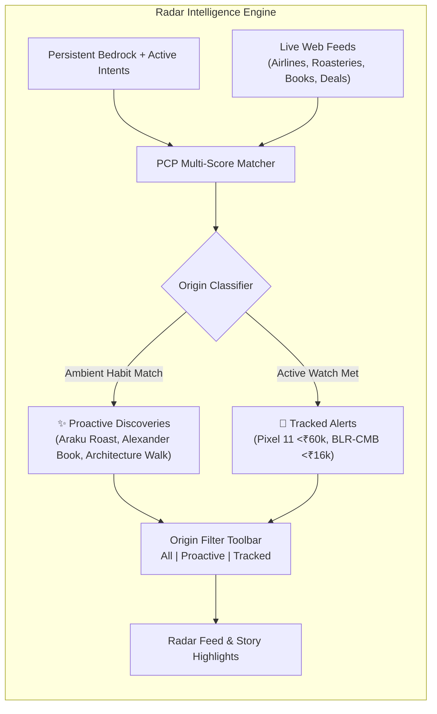
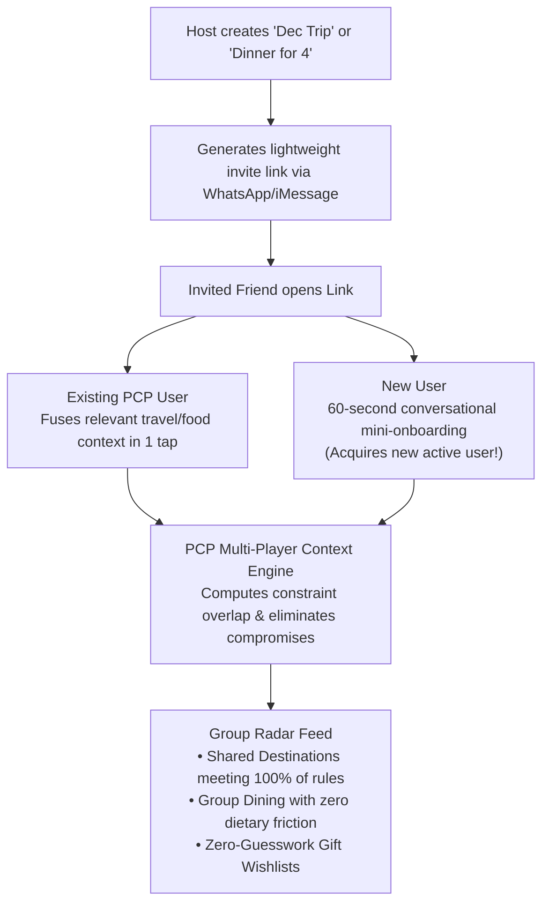

# PCP (Personal Context Profile) — Master Product Specification & Architecture Document

> **Document Version**: 2.0 (Master Build Blueprint)  
> **Target Audience**: Product Engineers, Designers, and AI Agents building the consumer application from scratch.  
> **Core Principle**: *"Your context. Your control."* — A sovereign, privacy-preserving personal context engine that turns AI memory into an active, proactive intelligence feed with zero ad surveillance, zero spam, and radical consumer simplicity.

---

## 1. Product Vision, Philosophy & Anti-Goals

### 1.1 What PCP Is
PCP is a **Sovereign Personal Context & Discovery Engine**. It extracts, synthesizes, and manages a user’s persistent lifestyle rules, physical constraints, values, and active short-term planning horizons (imported from AI assistants like ChatGPT, Claude, Gemini, or provided directly via voice/text). It then continuously evaluates real-world opportunities (price drops, travel windows, specialty coffee harvests, unamplified cultural events, architectural literature) against that personal context—surfacing only high-confidence, actionable opportunities with direct purchase/booking pathways.

### 1.2 Core Product Tenets
1. **100% Personal Data Sovereignty**: All personal context is owned exclusively by the user, stored securely/locally, fully editable, and exportable in 1 click. Zero third-party ad tracking, zero data brokering.
2. **Proactive Silence Over Noisy Spam**: PCP only surfaces 3 to 8 high-confidence opportunities at any given time. It strictly favors silence over low-confidence recommendations.
3. **Dual Horizon Architecture**: A foundational separation between **Persistent Bedrock** (rules that never change over years) and **Active Short-Term Focus** (time-bounded intents and price watches with auto-expiration).
4. **Radical Consumer Restraint**: Elimination of developer dashboards, nested accordions, score clutter, and prototype scaffolding. Every screen performs one clear function with generous whitespace, crisp typography, and high-taste aesthetics.
5. **Collaborative Multi-Player Fusion**: Organic viral distribution driven by "Scoped Context Sharing" for group trips, group dining, and zero-awkwardness gifting.

### 1.3 Anti-Goals (What PCP Is NOT)
- **NOT an Ad-Supported Attention Feed**: No sponsored ads, infinite scroll dopamine loops, or clickbait.
- **NOT a Generic Bookmarking / Notes App**: Context is active, actionable, and computationally matched against real-world web data.
- **NOT a Monolithic Social Network**: Sharing is strictly scoped, ephemeral, and task-driven (trips, dining, gifting).

---

## 2. Onboarding & First-Screen Strategy: Value-First Architecture

### 2.1 The "Value-First with Instant Transformation" Loop
Rather than presenting a blank gate or mandatory onboarding roadblock, the application opens immediately to an editorial, high-taste discovery baseline.

```
┌─────────────────────────────────────────────────────────────────────────────┐
│                       VALUE-FIRST ONBOARDING FLOW                           │
└─────────────────────────────────────────────────────────────────────────────┘

  [ 1. FIRST OPEN: CURATED BASELINE FEED ]
  • User sees high-quality curated sample cards (e.g. Rare Coffee Harvest,
    Long Weekend Travel Window, Architecture Book, Smartphone Deal).
  • Prominent floating Hero Hook:
    "Make this yours in 10s — Connect what ChatGPT or Claude knows about you."
                                    │
                                    ▼
  [ 2. ZERO-FRICTION INGESTION STUDIO (Choose 1 of 3) ]
  ├── A. Fast Track: 1-Click Paste AI Memory Export (ChatGPT / Claude / Gemini)
  ├── B. Voice Note: "Talk about yourself for 30 seconds" (Hands-free voice dictation)
  └── C. Quick Tap: 3-question lifestyle quiz (City anchor, travel style, taste)
                                    │
                                    ▼
  [ 3. THE "MAGIC MOMENT" MORPHING ANIMATION ]
  • Generic baseline cards dynamically animate, re-sort, and personalize
    into the user's exact Bangalore anchor, direct flight rules, compact phone
    constraints, and pour-over flavor profiles.
                                    │
                                    ▼
  [ 4. REVEAL & PERSISTENT RADAR ACCESS ]
  • User lands on their personalized Radar and is awarded their Lifestyle DNA Capsule.
```

---

## 3. Context Graph Architecture: The Dual Horizon Model

```mermaid
graph TD
    subgraph "Personal Context Profile (PCP)"
        Core["PCP Sovereign Graph"]
        
        subgraph "Dual Horizons"
            Bedrock["🔒 Persistent Bedrock (Long-Term)<br/>• Permanent lifestyle constraints<br/>• Family structure & child rules<br/>• Physical ergonomics (<6.3\" screens)<br/>• Single-origin pour-over taste<br/>• Core ethics & privacy sovereignty"]
            Active["⏱️ Active Focus & Windows (Short-Term)<br/>• Dec Family Beach Retreat (52d left)<br/>• Pixel 11 Price Watch (<₹60,000)<br/>• Sony A7CR Launch Offer Watch<br/>• Araku 40kg Harvest Release"]
        end
        
        subgraph "8 Canonical Domains"
            D1["👨‍👩‍👧 My World & Family"]
            D2["🏛️ What Matters & Values"]
            D3["✈️ Travel & Escapes"]
            D4["📱 Shopping & Hardware"]
            D5["☕ Food & Drink"]
            D6["📷 Interests & Craft"]
            D7["🎯 Goals & Planning"]
            D8["💬 How PCP Helps"]
        end
        
        Core --> Bedrock
        Core --> Active
        Bedrock --> D1
        Bedrock --> D2
        Bedrock --> D3
        Bedrock --> D4
        Bedrock --> D5
        Bedrock --> D6
        Bedrock --> D7
        Bedrock --> D8
    end
```

### 3.1 Horizon 1: Persistent Bedrock (Long-Term Foundation)
- **Nature**: Permanent rules, physical ergonomics, family anchors, and enduring values that remain stable across years.
- **Rule Lifecycle**: Never expires; updated only upon explicit user edit or direct correction.
- **Concrete Baseline Rules**:
  - *Home Anchor*: Home city is Bangalore, India (BLR departure point).
  - *Family Bedrock*: Married with one 7-year-old child; strict non-stop direct flight rule to eliminate transit fatigue; child-safe boutique stays.
  - *Hardware Ergonomics*: Phone screen size strictly under 6.3 inches for single-handed comfort; clean Android OS; ultralight 500g full-frame camera bodies.
  - *Taste Profile*: Specialty coffee preference for anaerobic light/medium roasts with floral (jasmine) and stone-fruit notes; neighborhood roasters on 100ft Road.
  - *Craft Values*: Personal data sovereignty, durability over transient hype, unamplified acoustic performing arts, unhurried morning routines.

### 3.2 Horizon 2: Active Focus & Seasonal Windows (Short-Term Intents)
- **Nature**: Time-bounded projects, active shopping watches, and seasonal holiday planning windows.
- **Rule Lifecycle**: Contains explicit expiration timestamps (`expiresAt`) and auto-archives once the date passes or the intent is fulfilled.
- **Concrete Active Intents**:
  - *Active Intent `i-1`*: "Upgrade primary phone to compact flagship under ₹60,000" (Active · 48 days remaining).
  - *Active Intent `i-2`*: "December 6-day family coastal retreat in Sri Lanka" (Active · Dec 20–27 · 52 days remaining).
  - *Active Watch `w-1`*: "Pixel 11 price drop below ₹60,000" (Trigger Met: ₹56,499).
  - *Active Watch `w-2`*: "BLR→CMB direct non-stop flights under ₹16,000" (Trigger Met: ₹14,200).

### 3.3 The 8 Canonical Life Domains
1. **`my-world` (My World & Family)**: Relationships, children, home base, daily schedules.
2. **`what-matters` (What Matters & Values)**: Ethics, craftsmanship, data privacy, lifestyle philosophy.
3. **`travel` (Travel & Escapes)**: Departure airports, flight rules, lodging styles, transfer tolerances.
4. **`shopping` (Shopping & Hardware)**: OS ecosystems, screen size limits, build quality, brand tiers.
5. **`food-drink` (Food & Specialty Coffee)**: Tasting notes, roast styles, dietary restrictions, dining vibe.
6. **`interests` (Interests & Craft)**: Photography, architecture, heritage dawn walks, literature.
7. **`goals` (Goals & Planning)**: Upcoming projects, purchase milestones, seasonal windows.
8. **`how-i-help` (How PCP Helps)**: Frequency preferences, notification quiet hours, digest formats.

---

## 4. Ingestion Engine & Extraction Prompts

### 4.1 AI Memory Extraction Prompts (Ready to Copy-Paste)

#### Standard Universal Ingestion Prompt (for ChatGPT / Claude / Gemini):
```text
Give me a comprehensive, structured summary of what you know about me from our conversations and memory. Focus strictly on durable information likely to remain useful across future interactions:
1. Personal and family context (locations, relationships, children, routines)
2. Travel style, flight rules, lodging preferences, and constraints
3. Shopping preferences, hardware form factors, brand choices, and decision rules
4. Food, specialty coffee, and dining tastes
5. Core values, craftsmanship standards, and communication preferences
6. Long-term goals and active upcoming projects

Format your response clearly, separating explicit facts from your inferences. Avoid summarizing temporary one-off coding bugs or transient tasks unless they reveal an enduring preference.
```

### 4.2 Ingestion Normalization Pipeline
1. **Token Ingestion**: Raw text/JSON or voice transcription is received.
2. **Entity & Constraint Extraction**: NLP pipeline identifies explicit facts (`married`, `child 7yo`, `Bangalore`), physical constraints (`<6.3" screen`, `direct flights only`), and preferences (`anaerobic pour-over`).
3. **Temporal Classification**: Assigns each item to `persistent_long_term` or `active_short_term` (with inferred expiration).
4. **Domain Routing**: Places rules into the 8 canonical domains with provenance metadata (`source: ChatGPT`, `confidence: 0.95`).

---

## 5. The Radar Intelligence & Discovery Engine



### 5.1 Proactive Serendipity vs. Requested Tracker Alerts

| Dimension | **✨ Proactive Discoveries** | **🎯 Requested Tracker Alerts** |
|---|---|---|
| **Origin Trigger** | Surfaced autonomously from ambient habits without explicit search. | Triggered because a live market condition satisfied an active watch/intent. |
| **Interface Badge** | Gold/Amber badge: `✨ Proactive Discovery` | Emerald badge: `🎯 Tracked Alert` + Trigger subtitle pill. |
| **Example** | Araku indiranagar seasonal micro-lot release; Christopher Alexander book at Champaca; Ranga Shankara acoustic evening. | Pixel 11 dropping to ₹56,499 (below ₹60k watch); BLR→CMB direct flight dropping to ₹14,200. |
| **User Mindset** | "I didn't know I needed this, but it fits my life perfectly." | "PCP did the research for me and alerted me at the right price." |

### 5.2 Multi-Score Matching Algorithm
Every candidate opportunity is scored across 5 normalized weights (0.0 to 1.0):

$$\text{Final Rank} = (w_r \cdot S_{\text{relevance}}) + (w_a \cdot S_{\text{actionability}}) + (w_f \cdot S_{\text{freshness}}) + (w_c \cdot S_{\text{confidence}}) + (w_n \cdot S_{\text{novelty}})$$

Where:
- $S_{\text{relevance}}$ ($w_r = 0.35$): Semantic cosine similarity with Persistent Bedrock rules.
- $S_{\text{actionability}}$ ($w_a = 0.25$): Direct external booking/buy URL verified, price in range.
- $S_{\text{freshness}}$ ($w_f = 0.20$): Hours since price drop, harvest date, or event schedule.
- $S_{\text{confidence}}$ ($w_c = 0.15$): Zero constraint conflicts (e.g. non-stop flight rule satisfied).
- $S_{\text{novelty}}$ ($w_n = 0.05$): Serendipity factor preventing repetitive recommendations.

### 5.3 Daily Pulse Story Highlights Tray
- Horizontal story tray across the top of Radar with glowing gradient story rings.
- Displays quick-skimming bullet summaries (*⚡ Price Drop, ☕ Micro-Lot, 🎟️ Saturday Pick, ✈️ Flight Window, 📚 Weekend Read*).
- Tapping opens an interactive full-screen story modal with bullet takeaways and direct action links.

---

## 6. Opportunity Deep Dive & Action System (`/radar/[id]`)

When a user taps into any opportunity card, the interface presents a structured, action-oriented hierarchy:

```
┌─────────────────────────────────────────────────────────────────────────────┐
│                      OPPORTUNITY DETAIL HIERARCHY                           │
├─────────────────────────────────────────────────────────────────────────────┤
│ 1. HERO BANNER: Full-bleed photo + Title + Origin Attribution Badge         │
│                                                                             │
│ 2. PROMINENT TOP ACTION BAR (Immediate Execution):                          │
│    • Verified Price: "₹56,499 (18% off ₹68,999)"                            │
│    • Direct CTA Button: "View Deal on Flipkart" / "Order on Araku" [ ↗ ]    │
│                                                                             │
│ 3. 3-WAY RE-ARCHITECTED TABS:                                               │
│    ├── TAB 1: 🔍 DEEP DIVE & DETAILS (Default First Tab)                    │
│    │   ├── Editorial Description & Origin Context                           │
│    │   ├── Key Highlights Checklist (Custom checkmarks)                     │
│    │   ├── Specifications & Logistics Table (Weight, screen, timing, etc.)  │
│    │   └── Commercial Terms & Pricing Breakdown                             │
│    │                                                                        │
│    ├── TAB 2: ✨ WHY IT FITS YOU                                            │
│    │   ├── Origin Attribution (Proactive vs Specifically Requested)         │
│    │   ├── Matched Persistent Bedrock Rules & Active Intents                │
│    │   └── Context Refinement Question with Voice Dictation Input           │
│    │                                                                        │
│    └── TAB 3: ⚖️ ALTERNATIVES & COMPARISONS                                 │
│        └── Side-by-side market alternative matrix (Pros, Trade-offs, Price) │
│                                                                             │
│ 4. FOOTER ACTIONS: Save for Later | 👍 Helpful | 👎 Not for Me              │
└─────────────────────────────────────────────────────────────────────────────┘
```

---

## 7. The Personal Context Hub & Lifestyle DNA (`/me`)

### 7.1 Persona Archetype Banner
Synthesizes the user's primary identity:
- **Archetype**: **"The Mindful Craftsperson & Quiet Explorer"**
- **Tagline**: *"High Durability • Zero Transit Friction • Artisanal Coffee Rituals • Quiet Heritage"*
- **Location Anchor**: Bangalore, India (BLR)

### 7.2 6-Axis Lifestyle DNA Matrix
An interactive multi-axis geometric radar polygon mapping:
1. **👨‍👩‍👧 Family Sanctuary & Calm (98%)**: Child-safe boutique stays, low transit friction.
2. **🛡️ Intentional Craft & Sovereignty (96%)**: Personal data sovereignty, durability over fast trends.
3. **📱 Minimalist Hardware & Ergonomics (95%)**: Phones under 6.3" screen display, stock Android OS.
4. **✈️ Low-Friction Quiet Travel (94%)**: Strictly non-stop direct flights from BLR, nature reserves.
5. **☕ Specialty Coffee & Gastronomy (92%)**: Anaerobic light/medium roasts, floral/fruit notes.
6. **🏛️ Cultural Arts & Systems Thinking (90%)**: Unamplified 200-seat acoustic theatre, architectural dawn walks.

### 7.3 Segmented Dual Horizon Matrix
- **Tab A: `🔒 Persistent Foundation (Long-Term)`**: Displays permanent constraints and bedrock rules.
- **Tab B: `⏱️ Active Focus & Intents (Short-Term)`**: Displays active planning goals, price watches, and seasonal windows with live countdown badges.

### 7.4 Living Story Tapestry
A continuous, magazine-style editorial biography with interactive highlighted keyword chips (*"Bangalore"*, *"7-year-old daughter"*, *"Direct flights from BLR"*, *"Anaerobic pour-over coffee"*) that display connected rules and real-world Radar impacts on tap.

### 7.5 Portable Context Capsule
A 1-click formatted Markdown/JSON export allowing the user to copy their verified profile and take it to any AI assistant (ChatGPT, Claude, etc.).

---

## 8. Multi-Player Context Fusion & Viral Distribution Engine



### 8.1 The Core Social Distribution Hooks
1. **Collaborative Trip & Weekend Capsules ("Group Travel Radar")**:
   - Host creates a shared capsule (e.g. *"December Beach Trip"*).
   - Participants join via a single WhatsApp/iMessage link.
   - Existing users fuse their travel rules in 1 tap; new users complete a 60-second conversational quiz (instantly acquiring a new user).
   - PCP calculates the **Constraint Overlap Sweet Spot**: surfaces flights and villas that satisfy 100% of non-negotiable rules for *all* members.
2. **Group Dining & Night Out ("Table for 4")**:
   - Fuses dietary restrictions, ambient noise tolerances, and commute radii across 4 people to surface 3 restaurants where everyone has great options without endless group debate.
3. **Zero-Awkwardness Gifting ("Gift Wish Capsule")**:
   - Users share a read-only, privacy-safe **Gift Capsule** with partners or close friends.
   - Shows unfulfilled interests, book genres, favorite coffee roasters, hardware form factors, or active watches with direct 1-click buy links—without spoiling the exact surprise.
4. **Scoped Privacy & Selective Disclosure**:
   - Multi-player fusion is **strictly scoped and ephemeral**: a dinner fusion only reads `food-drink` and `location`; personal health, finances, or unrelated shopping rules are cryptographically excluded.

---

## 9. Watching & Proactive Trackers Engine (`/watching`)

- **Live Background Trackers**: Silent monitors for price drops, flight availability, and limited releases.
- **Visual Status Gauges**: Real-time status pulses, price target comparisons (Target Met vs Monitoring), and cadence logs.
- **Active Planning Goals**: Time-bounded intent cards with progress trackers.

---

## 10. Complete TypeScript Data Models & Schemas

```typescript
// Core Domain Types
export type RadarDomain =
  | 'shopping'
  | 'travel'
  | 'food-drink'
  | 'books'
  | 'events'
  | 'interests'
  | 'what-matters'
  | 'my-world';

export type ContextHorizon = 'persistent_long_term' | 'active_short_term';
export type RecommendationOrigin = 'proactive' | 'requested';

// 1. Context Item Model
export interface ContextItemData {
  id: string;
  domain: RadarDomain;
  type: 'fact' | 'preference' | 'dislike' | 'constraint' | 'goal' | 'value' | 'relationship' | 'behavior_pattern' | 'decision_rule' | 'routine';
  key: string;
  value: string;
  durability: 'durable' | 'medium_lived';
  horizon: ContextHorizon;
  expiryCountdown?: string; // e.g. "Expires in 52 days"
  confidence: number;       // 0.0 to 1.0
  status: 'active' | 'archived' | 'conflicted';
  origin: 'imported' | 'user_answer' | 'user_edit' | 'feedback_inferred';
  explicitness: 'explicit' | 'inferred';
  sensitivity: 'normal' | 'sensitive' | 'highly_sensitive';
  lastConfirmedAt: string | null;
  createdAt: string;
  updatedAt: string;
  provenance: {
    provider: string;       // e.g. "ChatGPT", "Claude", "Voice Note"
    importId?: string;
    evidence?: string;
    sourceUrl?: string;
  };
}

// 2. Card Deep Dive Model
export interface CardDeepDive {
  description: string;
  keyHighlights: string[];
  specsOrDetails: Array<{ label: string; value: string }>;
  directActionUrl: string;
  directActionLabel: string;
  pricingBreakdown?: string;
}

// 3. Radar Discovery Card Model
export interface CardData {
  id: string;
  type: string;
  originType: RecommendationOrigin;
  requestedTriggerLabel?: string; // e.g. 'Triggered by your active watch: "Pixel 11 under ₹60,000"'
  domain: RadarDomain;
  title: string;
  summary: string;
  whyNow: string;
  heroImage: string;
  imageAlt: string;
  accentColor: string;
  relevanceReason: string[];
  contextIds: string[];
  intentIds: string[];
  watchIds: string[];
  relevanceScore: number;
  freshnessScore: number;
  confidenceScore: number;
  actionabilityScore: number;
  noveltyScore: number;
  createdAt: string;
  expiresAt?: string;
  status: 'active' | 'saved' | 'dismissed';
  deepDive: CardDeepDive;
  sourceEvidence: Array<{
    title: string;
    url: string;
    retrievedAt: string;
    price?: string;
    baselinePrice?: string;
    discountPercent?: number;
  }>;
  priceHistory?: Array<{ date: string; price: number; merchant: string }>;
  comparisons?: Array<{ name: string; matchScore: number; pros: string; cons: string; price: string }>;
  question?: {
    id: string;
    text: string;
    targetDomain: string;
    targetKey: string;
    options: string[];
  } | null;
}

// 4. Watch / Active Tracker Model
export interface WatchData {
  id: string;
  type: 'price' | 'availability' | 'route' | 'product' | 'travel';
  entity: string;
  criteria: string;
  targetPrice?: number;
  currentPrice?: number;
  currency: string;
  status: 'active' | 'paused' | 'expired';
  lastChecked: string;
  checkCadence: string;
  notificationMode: 'important_only' | 'digest' | 'all';
  observations: Array<{
    timestamp: string;
    price?: number;
    availability: string;
    sourceUrl: string;
    notes: string;
  }>;
}

// 5. Active Intent Model
export interface IntentData {
  id: string;
  category: 'shopping' | 'travel' | 'other';
  title: string;
  description: string;
  status: 'active' | 'fulfilled' | 'expired';
  createdAt: string;
  expiresAt: string;
}

// 6. Multi-Player Group Capsule Model
export interface GroupCapsuleData {
  id: string;
  type: 'trip' | 'dining' | 'gifting';
  title: string;
  hostUserId: string;
  inviteCode: string;
  scopedDomains: RadarDomain[]; // e.g. ['travel', 'food-drink']
  members: Array<{
    userId: string;
    name: string;
    isPcpUser: boolean;
    contributedRuleIds: string[];
  }>;
  fusedOpportunities: CardData[];
  createdAt: string;
  expiresAt: string;
}
```

---

## 11. Screen Architecture & Core Navigation

```
┌─────────────────────────────────────────────────────────────────────────────┐
│                       CORE APPLICATION NAVIGATION                           │
├─────────────────────────────────────────────────────────────────────────────┤
│ 1. RADAR (Home / Discoveries Feed)                                          │
│    • Origin Filter Toolbar: All (8) | ✨ Proactive (5) | 🎯 Tracked (3)     │
│    • Category Filter Chips: All | 📚 Books | ☕ Food | 🎟️ Events | ✈️ Travel │
│    • Story Highlights Tray: Glowing gradient daily pulse bubbles            │
│    • Discovery Cards: Hero image, snippet pills, why now, and direct action │
│                                                                             │
│ 2. OPPORTUNITY DEEP DIVE (/radar/[id])                                      │
│    • Top Action Bar: Live verified price + Direct Buy/Book external link    │
│    • Tab 1: 🔍 Deep Dive & Details (Editorial, Highlights, Specs, Pricing)  │
│    • Tab 2: ✨ Why It Fits You (Origin attribution, matched rules, voice Q) │
│    • Tab 3: ⚖️ Alternatives & Trade-Offs (Side-by-side comparison matrix)  │
│                                                                             │
│ 3. ME (Personal Context & Lifestyle DNA)                                    │
│    • Persona Archetype: "The Mindful Craftsperson & Quiet Explorer"         │
│    • 6-Axis Lifestyle DNA Hologram Matrix (Interactive geometric polygon)   │
│    • Dual Horizon Tabs: 🔒 Persistent Bedrock vs ⏱️ Active Focus & Intents │
│    • Living Story Tapestry: Continuous editorial narrative with rule tokens │
│    • 1-Click Portable Context Capsule Export Tool                           │
│                                                                             │
│ 4. WATCHING (Active Trackers & Goals)                                       │
│    • Live Price & Inventory Trackers (Pixel 11, BLR-CMB flight, Sony A7CR)  │
│    • Active Planning Intents with live countdowns & milestones              │
│    • Voice-Assisted Tracker Creation ("Watch direct flights to Colombo")    │
│                                                                             │
│ 5. MULTI-PLAYER CAPSULES (Group Radar & Gifting)                            │
│    • Group Travel Capsules: Shared constraint sweet spot solver             │
│    • Group Dining: Multi-diet restaurant matcher                            │
│    • Wish Capsules: Privacy-safe gifting radar with 1-click buy links       │
│                                                                             │
│ 6. DATA SOVEREIGNTY & SETTINGS                                              │
│    • Full transparent item audit list (edit/delete any single rule)         │
│    • Raw JSON / Markdown export & local encryption controls                 │
└─────────────────────────────────────────────────────────────────────────────┘
```

---

## 12. Implementation Stack & Technical Recommendations

- **Framework**: Next.js 16 (App Router) + React 19 + TypeScript 5
- **Styling**: Tailwind CSS v4 (`@theme inline` with custom tokens for typography, surfaces, and micro-interactions)
- **Voice Capabilities**: Web Speech API (`SpeechRecognition` with fallback simulation)
- **Data Persistence**: Local-First IndexedDB / localStorage (Client-Side) + optional Supabase/PostgreSQL backend for Multi-Player Capsule synchronization
- **Deployment**: Vercel Production (`Edge / Serverless Functions` + Turbopack builds)
